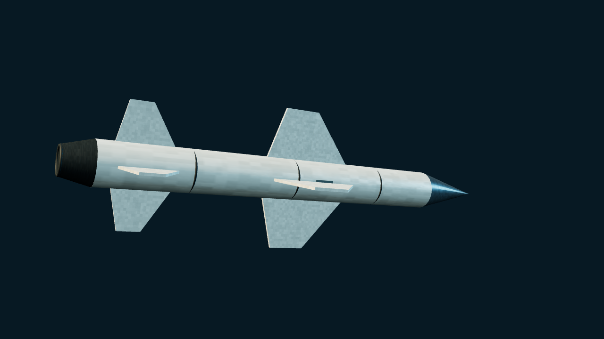

# 80式空射反舰导弹 / ASM-1

> 当前 main · Unreleased。80式基础型，不含 ASM-2/ASM-3。

[武器目录](README.md) · [参数总表](MISSILE_PARAMETERS.md) · [English](../en/WEAPONS/ASM1_TYPE80.md)

## 公开资料与外形

日本研制的亚音速空射反舰导弹，采用固体火箭、惯性导航和主动雷达末制导。公开数据约为长 4 米、直径 0.35 米、翼展 1.2 米、战斗部 150 千克、射程 50 千米。独立模型采用尖形雷达罩、较长后掠十字翼和火箭喷口，**不添加吸气式发动机进气道**。

## 游戏实现

- 稳定 ID：`ASM-1`；定义位于 `src/threats/asm1.ts`。
- 使用 `ASM-1 RAID` 或场景 JSON 的 `in-flight` 波次。本轮只模拟已离架来袭，不新增 F-1 载机，不给 A-6E 等现有飞机添加非历史挂载。
- 巡航/末端高度 `0.4 / 0.14`，速度 `5.8 / 6.4`，毁伤 `18`，RCS `0.13`；沿用通用来袭飞行模型，不模拟完整火箭推力/滑翔曲线。
- 默认生成距离 `360` 世界单位不是现实最大射程。
- 复用探测、SAM/CIWS、ECM、箔条和 AAR/Tacview；无 HOJ、跃升或蛇形机动。预置来袭沿用简化末段激活与反制引偏，未新增独立捕获/失锁状态机。

## 来源

- [80式空射反舰导弹 — 维基百科](https://zh.wikipedia.org/wiki/80式空射反舰导弹)。
- [Type 80 Air-to-Ship Missile — Wikipedia](https://en.wikipedia.org/wiki/Type_80_Air-to-Ship_Missile)，查阅日期 2026-10-24，用于基础型尺寸、动力、制导和战斗部参考。游戏中的 RCS、毁伤和概率均为模拟假设。
