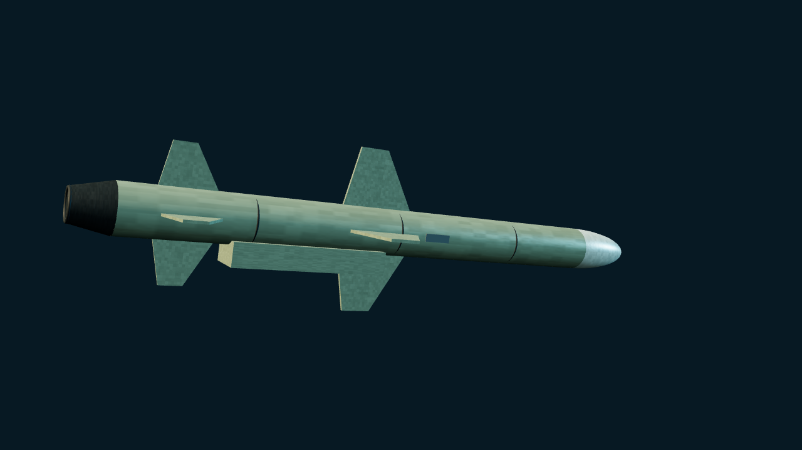

# R-360 海王星 / Neptune

> 当前 main · Unreleased。仅基础反舰型，不含对陆型或 Long Neptune。

[武器目录](README.md) · [参数总表](MISSILE_PARAMETERS.md) · [English](../en/WEAPONS/R360_NEPTUNE.md)

## 公开资料与外形

乌克兰研制的亚音速反舰巡航导弹，采用吸气式巡航动力与主动雷达末制导。公开资料列出约 5.05 米总长、0.38 米直径、150 千克战斗部及约 280 千米级射程；总长口径可能包含助推段，不作为游戏巡航模型的工程尺寸保证。程序化外形突出细长弹体、圆弧雷达罩、后掠十字翼和腹部进气道；不表现发射车或助推器分离。

## 游戏实现

- 稳定 ID：`R-360 Neptune`；定义位于 `src/threats/neptune.ts`。
- 沙盒选择 `NEPTUNE RAID`，或在场景 JSON 中使用 `in-flight` 波次。没有新增岸基发射平台。
- 巡航/末端高度为 `0.3 / 0.1`，速度 `5.8 / 6.4`，毁伤 `18`，RCS `0.14`。这些均为游戏化参数，不是现实性能。
- 默认生成距离 `500` 是世界单位；默认场景尺度下相当于 50 千米，**不是最大射程**。没有模拟公开射程对应的全程燃油消耗。
- 复用已有雷达、SAM、CIWS、ECM、箔条及 AAR/Tacview 流程；不启用 HOJ、跃升或蛇形机动。
- 沿用现有预置来袭弹的简化末段：进入末段即启用主动寻的表现，反制可引偏；本轮未新增独立的捕获/失锁状态机。不能将此描述为完整导引头仿真。

## 来源

- [R-360 Neptune — Wikipedia](https://en.wikipedia.org/wiki/R-360_Neptune)，基础型号、尺寸、动力和战斗部；查阅日期 2026-10-24。页面中的后续增程/对陆型号不用于本定义。

现实资料用于型号与外形参考；RCS、烧穿、毁伤和拦截概率均为模拟器假设。
