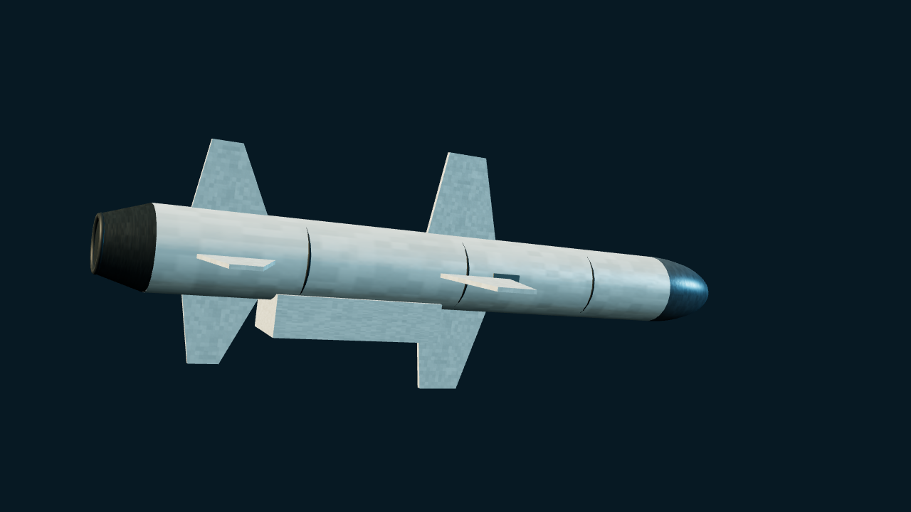

# Kh-35 / 3M24 Uran

> Current main · Unreleased. Baseline variant, excluding Kh-35U/UE range upgrades and land attack.

[Weapons](README.md) · [Parameters](MISSILE_PARAMETERS.md) · [中文](../../WEAPONS/3M24_URAN.md)

## Public reference and appearance

3M24 Uran is the baseline naval member of the Kh-35 family. Public figures include roughly 3.85 m cruise-body length, .42 m diameter, 1.33 m span, a 145 kg warhead and about 130 km range. It uses air-breathing cruise propulsion, inertial navigation and terminal active radar guidance. The asset represents the post-booster cruise configuration: a shorter, wider body, rounded radome, cruciform wings and a partly recessed ventral intake distinguish it from Neptune.

## Game implementation

- Stable ID: `3M24 Uran`; definition: `src/threats/uran.ts`.
- Use `URAN RAID` or an `in-flight` scenario wave. No Moskva launch-slot compatibility or aircraft loadout is added.
- Cruise/terminal altitude: `.3 / .08`; speed: `5.8 / 6.4`; damage: `17`; RCS: `.12`. These are game parameters.
- Default spawn distance `420` world units is not maximum range or a full-range propulsion/fuel model.
- Existing sea-skimming guidance, radar, SAM/CIWS, ECM/chaff and AAR paths apply. No HOJ, pop-up or weaving capability.
- Pre-spawned threats retain simplified terminal activation and countermeasure diversion, without a new independent acquisition/loss state machine.

## Source

- [Kh-35 — Wikipedia](https://en.wikipedia.org/wiki/Kh-35), consulted 2026-10-24. Baseline figures are kept separate from U/UE variants. Appearance references do not make game damage, RCS or countermeasure probabilities real-world data.
